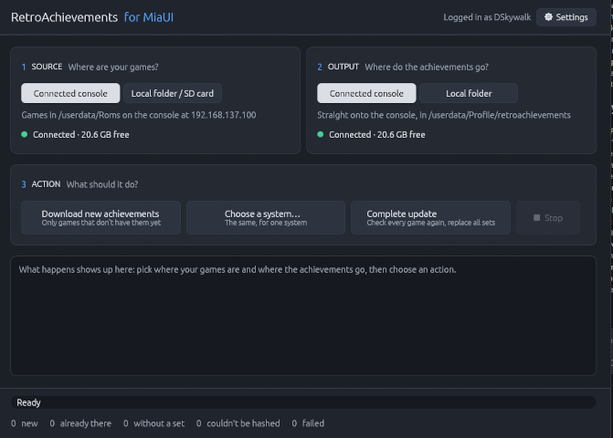

# 🐱 RetroAchievements downloader for MiaUI

Downloads the RetroAchievements sets for your games on a PC, for [MiaUI](https://github.com/miaui-cfw/MiaUI-GPU-RG35XX)'s offline achievements.
It works like the console's own RetroAchievements app, but uses the PC's internet connection, so the console needs no Internet Connection Sharing if you have problems with the internal app.


## How to Use It (The USB Workflow)

The easiest and safest way to manage your achievements is directly over the USB cable. This means you don't have to constantly remove your SD card, saving the SD slot from wear and tear! 

Here is the step-by-step workflow:

1. **Connect the Console:** Plug your console into your PC using a USB-C cable. On the console, activate the **USB Network** mode. 
   *(Tip for Windows users: if you don't need developer access, use the standard network mode without ADB to keep things simple).*
2. **Verify the Connection:** Open your favorite web browser on your PC and navigate to `http://192.168.137.100` (Make sure it is `http://` and not `https://`). If you see the MiaUI Web Manager page, your connection is working perfectly!
3. **Setup the App:** Open `ra_fetch_gui`. Click the **⚙ Settings** (top right) and log in with your RetroAchievements username and password (your password is never saved, just the access token). 
4. **Select the Console:** On the main screen, set both **SOURCE** and **OUTPUT** to **Connected Console**. 
5. **Fetch!** Click on **Download new achievements**. This is the option you will use most of the time. The app will scan your console, download any missing achievement sets, and send them straight back to the device.


---

### Interface Reference

* **⚙ Settings:** Stores your login session token. The default API IP is `192.168.137.100` unless you have customized your console's network script (idk why, but).
* **SOURCE:** 
  * **Connected Console:** Reads your game list and hashes directly from the running console.
  * **Local Folder / SD Card:** If your SD card is plugged into the PC, point this to your `Roms` folder.
* **OUTPUT:** 
  * **Connected Console:** Sends the downloaded `.json` files straight into the console's `/userdata/Profile/retroachievements` folder via the API.
  * **Local Folder:** Saves the files to a local `<folder>/Profile/retroachievements` path. 
* **ACTIONS:**
  * **Download new achievements:** Scans and downloads only the missing sets (Fastest).
  * **Choose a system…:** Same as above, but filtered for a single platform (e.g., just Game Boy).
  * **Complete update:** Forces a redownload of every game, replacing existing sets.
  * **Stop:** Safely aborts the current process without losing what has already been downloaded.

## Building

```
cargo build --release                                   # Linux
cargo build --release --target x86_64-pc-windows-gnu    # Windows (mingw-w64)
cargo test --release                                    # unit tests
```
